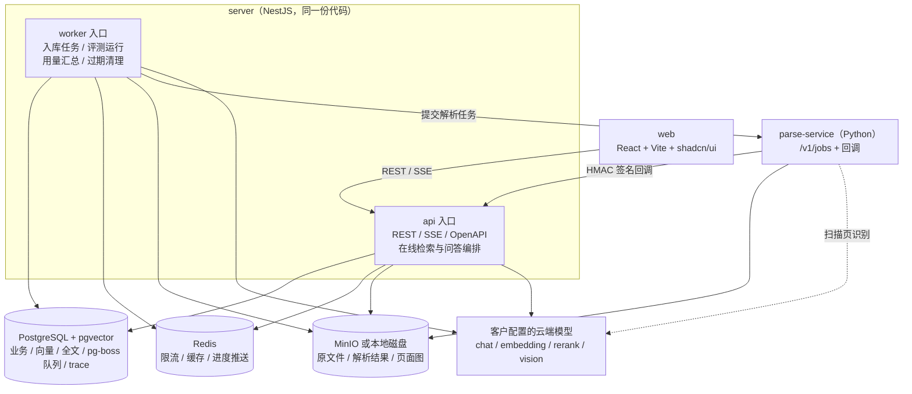
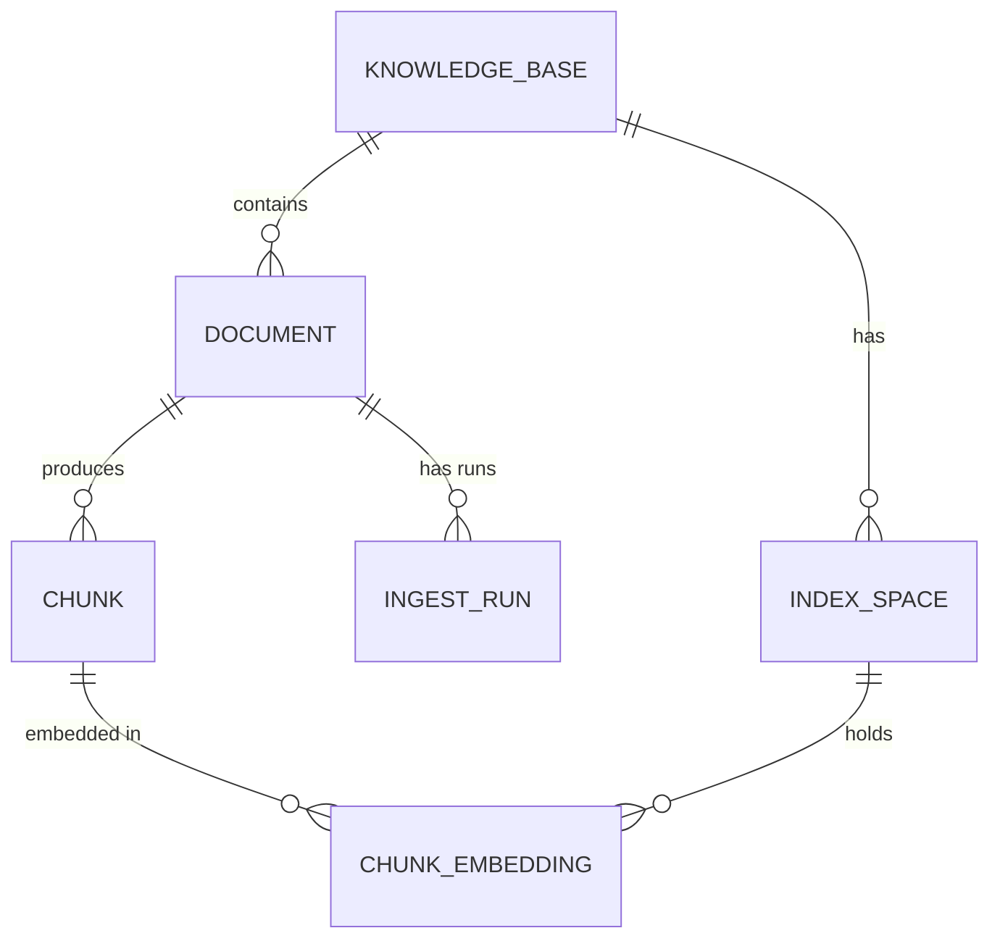

# 智能体开发平台：总体技术方案

> 版本：v1.0　更新日期：2026-10-10
> 产品需求：`智能体开发平台-需求文档.md`（PRD）
> 调研与参考仓库：`智能体开发平台-调研与规划.md`
> 本文取代：`智能体开发平台 · 知识库 MVP 设计文档.md`（2026-09-17）中的产品定位和技术选型；其中仍然适用的工程设计已并入本文

---

## 1. 文档关系与裁决

### 1.1 三份文档的关系

| 文档 | 日期 | 定位 | 在本文中的地位 |
|---|---|---|---|
| 知识库 MVP 设计文档 | 2026-09-17 | 面向智能体开发者；入库 / 检索做成画布 Pipeline；Python；无租户、无 API Key、无评测集 | **产品定位已过时**；工程细节（解析协议、入库状态机、原子替换、向量方案、限流）大部分沿用 |
| 调研与规划 | 2026-10-10 | 参考 WeKnora / 万悟；TypeScript 全栈；可信 → 可用 → 可管 | 技术栈与排序原则的基线 |
| 需求文档（PRD） | 2026-10-10 | 内部知识问答；业务 + 研发双角色；多租户；私有化交付；详细监控；品牌定制 | **产品基线** |

### 1.2 已确认的前提（2026-10-10）

- 团队 **1 人**；平台用 **TypeScript**，文档解析服务用 **Python**
- 画布式 Pipeline **推迟到阶段 E**：代码内部按节点组织，界面只提供表单
- 其余前提见 PRD 第 2 节（私有化交付、客户自带云端模型、不做计费 / License / 合规、知识库级权限）

### 1.3 冲突裁决

| 议题 | 9-17 MVP | 10-10 PRD / 规划 | 结论 | 理由 |
|---|---|---|---|---|
| 目标用户 | 智能体开发者 | 业务人员 + 研发 | PRD | 成功标准是"业务人员 30 分钟搭好" |
| 入库 / 检索配置 | 画布 Pipeline（DAG + DSL） | 表单 + 默认值 | **表单；代码内部是节点** | 见 4.1 |
| 人工审核节点 | 阻塞式审核，带超时 | 无；用切片预览 / 编辑 | PRD | 暂停 / 恢复状态机复杂，试点阶段价值低 |
| 后端语言 | Python | TypeScript | TS 平台 + Python 解析服务 | 共享 zod schema 是"表单与 YAML 编辑同一份配置"的基础；MCP 官方 SDK 是 TS |
| 隔离字段 | `workspace_id` | `tenant_id` | `tenant_id` + `space_id` | 9-17 的 workspace 对应 PRD 的 space |
| API Key | 不做 | 阶段 A 就要 | PRD | 评测脚本和研发用户依赖它 |
| 评测集 | 不做 | 第 1 周交付 | PRD | 没有它，检索改动无法判断好坏 |
| 向量维度 | `chunk_embedding` + halfvec + 按 index_space 建部分 HNSW | 待定 | **采用 9-17** | 直接解决 PRD 待确认项 |
| 更换 Embedding 模型 | 支持（重建 index_space） | 不可更改 | 表结构按 9-17 建，重建功能放 D | 现在不增加成本，以后不用迁移数据 |
| 关键词检索 | ParadeDB pg_search（AGPL） | Postgres 全文检索 | **应用层 jieba 分词 + tsvector** | 见 5.4；对外分发的许可证风险 |
| 链路追踪 | Arize Phoenix（ELv2） | 自建 trace / span 表 | **自建表，可选 OTel 导出** | 平台内要按租户查看；ELv2 不适合交给客户 |
| 任务队列 | Procrastinate（PG） | BullMQ（Redis） | **pg-boss（PG）** | 任务状态和业务数据在同一个库、同一个事务；Redis 丢了不影响主流程 |
| 解析服务 | 独立服务，builtin（PyMuPDF）+ MinerU | Python docreader | **沿用 9-17 协议，换引擎组合** | PyMuPDF 是 AGPL；客户不一定有 GPU（见 5.2） |

---

## 2. 设计原则

1. **可信 → 可用 → 可管**：回答质量不过关，其他功能都没有意义。
2. **评测集先于检索代码**：第 1 周就建，每次改动跑分。
3. **用量与链路从第一天写入**：只入库，看板后做。
4. **不提前抽象**：模型只接 OpenAI 兼容协议（重排另有一个协议），向量只用 pgvector，队列只用 pg-boss。
5. **留接缝，不填满**：`tenant_id` 强制过滤、模型调用的审核钩子、配置 `schema_version`、品牌从接口读取、`IndexBackend` 接口。
6. **组件最少**：1 人维护，强一致状态只放 Postgres；Redis 只放丢了也没关系的数据。
7. **私有化优先**：运行时不访问外网；默认安装包内没有 AGPL / ELv2 组件。

---

## 3. 总体架构

### 3.1 组件



| 组件 | 说明 |
|---|---|
| `web` | Nginx 托管静态文件并反向代理 `/api`；所有资源本地打包 |
| `api` | 可多副本；检索在进程内执行（低延迟） |
| `worker` | 可横向扩展；消费 pg-boss 队列 |
| `parse-service` | 独立部署、可单独使用；自带任务队列，不访问平台业务库 |
| PostgreSQL | 官方镜像 + pgvector；不需要自建扩展 |
| Redis | 关闭持久化，淘汰策略 `volatile-lru` |
| 对象存储 | MinIO（S3 协议）或本地磁盘，封装在 `ObjectStore` 接口后 |

### 3.2 工程结构

```
apps/
  server/            NestJS（api.ts / worker.ts 两个入口）
    src/modules/
      iam/           用户、租户、空间、成员、角色、API Key、JWT
      model/         供应商与模型登记、密钥加密、连通性测试、单价、ModelClient
      knowledge/     知识库、文档、切片、FAQ、入库流水线、检索流水线
      agent/         配置 schema、草稿 / 版本、问答编排
      tool/          HTTP 工具、MCP 客户端
      chat/          会话、消息、引用、反馈、SSE、OpenAPI
      observe/       trace / span、usage、质量指标、健康检查、/metrics
      eval/          评测集、评测运行、打分
      system/        品牌、系统设置、初始化向导
    src/core/        租户上下文、Repository 基类、ObjectStore、IndexBackend、RateLimiter
  web/               React 前端
  parse-service/     Python（FastAPI + uv）
packages/
  shared/            zod schema：智能体配置、知识库配置、ParsedDocument、接口类型
deploy/
  docker-compose.yml、offline/（离线安装包脚本）
```

### 3.3 技术栈

| 层 | 选择 | 备注 |
|---|---|---|
| 后端框架 | NestJS | 模块化 + 依赖注入；分层 Controller → Service → Repository |
| ORM / 迁移 | Drizzle + drizzle-kit | 原生支持 pgvector；启动时自动迁移 |
| 校验 | zod（`packages/shared`） | 前后端、YAML 导入共用 |
| 模型调用 | Vercel AI SDK（chat / embedding） | 重排用自封装的 HTTP 客户端 |
| MCP | `@modelcontextprotocol/sdk` | Streamable HTTP / SSE |
| 队列 | pg-boss | 基于 Postgres |
| 中文分词 | `@node-rs/jieba` | 见 5.4 |
| 前端 | React + Vite + shadcn/ui + TanStack Query / Table | 1 人开发，不自建组件库 |
| 解析服务 | Python + FastAPI + uv；Docling | 见 5.2 |
| 工程 | pnpm workspace + Turborepo | |

---

## 4. 贯穿全局的机制

### 4.1 "代码里是节点，界面上是表单"

9-17 文档的节点思想保留，但不做画布、DSL、路由节点、人工审核节点：

- **入库**：`parse → clean → chunk → embed → write`
- **检索**：`(vector ∥ keyword) → fuse(RRF) → rerank → threshold → (parent backfill)`

每一步是一个带类型输入输出的函数，参数来自知识库上的 `chunk_config` / `retrieval_config`（zod schema，带默认值）。每一步自动生成一个 span，所以检索测试页和调试面板能逐步展示中间结果。以后要做画布时，这些步骤就是现成的节点。

### 4.2 租户上下文

- 请求进入时解析出 `{ tenantId, spaceId?, userId | apiKeyId, traceId }`，放进 `AsyncLocalStorage`。
- Repository 基类所有查询自动追加 `tenant_id = ?`；绕过基类的查询必须显式标注并经过评审。
- worker 处理任务时从任务数据中恢复上下文。
- 自动化测试：两个租户各建一套数据，遍历所有列表 / 详情 / 检索接口，断言不会串数据。
- 阶段 A 只有一个默认租户和单管理员，但表结构和上下文从第一天就有。

### 4.3 统一 ModelClient

平台里所有模型调用都必须经过 `ModelClient`：

```
调用方 ──▶ ModelClient
            ├─ beforeHook()                       # 审核钩子，先空实现
            ├─ RateLimiter.acquire(modelId)       # Redis 全局并发 + QPS
            ├─ cache.get()                        # 仅检索时的 query embedding
            ├─ span.start(kind = llm|embedding|rerank)
            ├─ 调用（超时、重试；P1 加备用模型）
            ├─ usage.record(tokens, latency, status)
            ├─ afterHook()
            └─ RateLimiter.release()
```

- **限流**（沿用 9-17 §6.3）：每个模型一个信号量 + 令牌桶，Lua 原子执行，槽位带 TTL；Redis 不可用时退化为进程内限流（总额按进程数平分）并告警。
- **缓存**：`emb:{modelId}:{sha256(text)}`，TTL 1 天；Redis 不可用时跳过。
- **密钥**：AES-256-GCM 加密存储，主密钥来自环境变量 `APP_MASTER_KEY`；界面只显示掩码；日志和 span 中不出现明文。
- **用量**：`usage_record` 只由 ModelClient 写，业务代码不关心。维度从租户上下文取（租户 / 空间 / 智能体 / 用户 / API Key / 模型）。

### 4.4 链路追踪

- 每次问答、每次入库、每次评测运行各一个 trace；span 写入自有的 `trace` / `span` 表（按天分区，保留天数可配）。
- span 类型：`retrieval`、`rerank`、`llm`、`embedding`、`tool`、`parse`、`step`。
- 数据量控制（沿用 9-17 §15.3）：文本字段截断到 2000 字符；切片列表只存条数、前几条样例和 ID；完整中间结果只存对象存储地址。
- 结构化 JSON 日志，每条带 `trace_id`。
- OTel 导出（Langfuse / Phoenix 等）作为 P2 可选项，由环境变量开启；Phoenix 只在开发环境自用，不打进安装包。

### 4.5 配置版本

- 智能体配置、知识库配置、ParsedDocument 都带 `schema_version`；导入旧版本时按版本迁移。
- 智能体发布生成不可变的 `agent_version`；消息关联 `agent_version_id`。
- 评测运行记录当时的知识库配置快照和智能体版本。

### 4.6 品牌

前端不写死产品名和 Logo，所有品牌元素从 `/api/branding` 读取，从阶段 A 起遵守；品牌编辑界面在阶段 C 做。

---

## 5. 知识库

### 5.1 概念与数据流



上传 → 存原文件（按 `file_hash` 去重）→ 建 `document` + `ingest_run` → 入队 → worker 提交解析任务 → 解析服务回调 → 清洗、切片、向量化 → 一个事务内写入。

### 5.2 文档解析服务（parse-service）

沿用 9-17 文档 §11 的协议设计，调整引擎组合。

**接口**

```http
GET  /v1/engines                      # 返回可用引擎、支持格式、是否带 bbox、是否支持扫描件
POST /v1/jobs                         # file_uri, engine(auto|docling|vision|mineru), options, output_prefix, callback_url
GET  /v1/jobs/{job_id}                # status, progress, result_uri, pages, error
POST /v1/parse:sync                   # 小文件 / 检索测试用；有大小和耗时上限
```

- 结果写入对象存储 `output_prefix`：`parsed.json`、`pages/{n}.png`、`images/{id}.png`
- 回调请求体用 HMAC 签名；请求头透传 `traceparent`
- 平台侧另有周期任务，主动查询超时未回调的任务

**引擎**

| 引擎 | 阶段 | 说明 |
|---|---|---|
| `docling` | A（默认） | MIT；CPU 可运行；原生支持 PDF / DOCX / PPTX / XLSX / HTML / MD |
| `plain` | A | txt / md / csv 直接读取 |
| `vision` | P1 | 扫描页 / 图片调用**客户配置的**云端多模态模型（模型地址和密钥由平台在任务里下发） |
| `mineru` | 可选 | 客户有 GPU 时启用；发版前复核其许可证条款 |
| `auto` | A | 有文本层的 PDF 和 Office 用 docling；扫描页用 vision（未配置则报错并提示） |

> 9-17 文档选的 PyMuPDF 是 AGPL-3.0，对外分发不使用。PDF 如需更底层的处理，用 `pypdfium2`（Apache / BSD）或 `pdfplumber`（MIT）。

**ParsedDocument**（沿用 9-17 §11.3，TS 侧在 `packages/shared` 用 zod 镜像一份）

```ts
type ParsedDocument = {
  schemaVersion: 1;
  source: { fileName: string; mime: string; engine: string; engineVersion: string };
  pages: { pageNo: number; width: number; height: number; imageUri?: string }[];
  elements: {
    id: string;
    type: 'title' | 'paragraph' | 'list_item' | 'table' | 'image' | 'formula'
        | 'code' | 'header' | 'footer' | 'caption' | 'other';
    level?: number;          // 标题层级
    text?: string;
    html?: string;           // 表格
    imageUri?: string;
    pageNo?: number;         // PDF 页码 / PPT 页号；Word 为空
    bbox?: [number, number, number, number];
    order: number;           // 阅读顺序
  }[];
};
```

**引用定位按格式区分**

| 格式 | 定位方式 |
|---|---|
| PDF | 页码 + bbox（可在页面图上高亮） |
| PPT | 页号 |
| Word | 章节路径（Word 没有稳定页码，分页取决于排版） |
| Excel | 工作表名 + 行号 |
| Markdown / TXT | 章节路径 / 段落序号 |

### 5.3 切片

| 规则 | 说明 |
|---|---|
| 默认策略 | 按标题结构切分，超长段落再按分隔符递归切分（`\n\n` → `\n` → `。` → `；`） |
| 默认参数 | 长度 512 token、重叠 50；业务人员通常不用改 |
| 标题路径 | 每个切片带 `heading_path`（如"第三章 > 3.2 报销标准"）；`embed_text` = 标题路径 + 正文 |
| 表格 | 小表按行转文本，每行带表头；大表（超过阈值）按行分组，每组带表头 |
| PPT | 一页一个切片起步，太长再切 |
| 页眉页脚 | 按跨页重复内容识别并去除 |
| 父子切片 | 表结构支持（`parent_id`、`is_parent`），默认不启用；评测集显示上下文不足时再开 |

`chunk` 字段：`content`（展示 + 关键词检索）、`embed_text`（向量化）、`heading_path`、`source_refs`（元素 ID、页码、bbox）、`position`（相邻扩展）、`tsv`、`enabled`、`origin`（pipeline / manual）、`edited`。

### 5.4 中文关键词检索

Postgres 自带的全文检索不会切分中文，PRD 中"Postgres 全文检索"需要补上分词：

- **方案**：应用层用 `@node-rs/jieba` 分词，写入 `to_tsvector('simple', '<空格分隔的词>')`；查询时同样分词后构造 `tsquery`（词之间用 OR，靠排序区分）。
- **索引**：`tsv` 上建 GIN 索引。
- **自定义词典**：知识库级 / 租户级词表，入库和查询都加载；修改词典后提示重建该知识库的 `tsv`（只重算分词，不重新向量化）。
- **排序**：`ts_rank_cd` 不是 BM25，但在"混合检索 + 重排"的链路里影响有限，用评测集验证；不够时再评估 zhparser / pg_jieba 扩展或 pg_search（AGPL，需法务评估）。
- 封装在 `IndexBackend.keywordSearch()` 后，替换实现不影响调用方。

### 5.5 向量存储（index_space）

沿用 9-17 §7.2 与 §14.1：

```sql
index_space(id, tenant_id, kb_id, embedding_model_id, dim, status /* building|active|retired */)
chunk_embedding(chunk_id, space_id, embedding halfvec)          -- 不限定维度

-- 建 space 时由程序动态创建部分 HNSW 索引
CREATE INDEX chunk_emb_<space> ON chunk_embedding
  USING hnsw ((embedding::halfvec(1024)) halfvec_cosine_ops)
  WHERE space_id = '<space_uuid>';
```

- 查询时带上相同的表达式和 `space_id` 条件，才能命中部分索引；统一写在 `IndexBackend.vectorSearch()` 里，并用 `EXPLAIN` 测试锁定。
- 阶段 A–C：每个知识库只有一个 active space，创建后不可更换模型（与 PRD 一致）。
- 阶段 D：开放"更换 Embedding 模型"——新建 building space，后台重算，原子切换（9-17 §7.2 时序图）。

### 5.6 入库运行模型

沿用 9-17 §7.5、§9.2–9.5，去掉人工审核和路由分支：

- **运行单位**：每个文档一次 `ingest_run`，失败、重试互不影响。
- **文档状态**：`UPLOADED → QUEUED → PARSING → PROCESSING → READY`，任一步可到 `FAILED`；`FAILED → QUEUED`（重试）；`READY → QUEUED`（新版本 / 重跑）。另有 `has_active_chunks` 表示旧切片是否仍在提供检索。
- **步骤**：`parse`（外部等待）→ `process`（clean + chunk + embed，worker 内执行）→ `write`。
- **重试**：每步指数退避重试 3 次；`ingest_run` 记录完成到哪一步，重试从失败处继续。
- **幂等**：每步开始时检查状态，已完成的跳过；回调重复投递无副作用。
- **原子写入**：`write` 在一个事务内删除该文档旧切片和向量 → 插入新切片和向量 → 更新文档状态与版本。提交前检索看到的都是旧数据；失败则回滚。
- **新版本替换**：同一文档上传新版本时，文档 `version + 1`，走同样流程；成功后旧切片被替换。
- **手工编辑的切片**：重跑前提示"有 N 处手工修改将被覆盖"。
- **批处理与限流**：向量化按批调用，每批经过 RateLimiter。
- **进度推送**：worker 更新状态后发布到 Redis 频道 `t:{tenantId}:ingest`，API 通过 SSE 推给前端；前端收到后让查询失效并重新拉取，事件只做通知；Redis 不可用时前端每 3 秒轮询。

### 5.7 检索与回答

**检索流水线（默认配置）**

| 步骤 | 默认 | 说明 |
|---|---|---|
| 查询改写 | 关（P1） | 多轮对话补全指代 |
| 向量召回 | top 30 | 按每个知识库的 active space 分别召回 |
| 关键词召回 | top 30 | 5.4 |
| 融合 | RRF，k = 60 | |
| 重排 | 开，top 8 | 客户未配置重排模型时自动跳过 |
| 阈值 | 按重排分数 | 低于阈值的丢弃；全部低于阈值则走拒答 |
| FAQ | P1 | 精确 / 高相似命中时优先使用 |

**回答**

- 简单问答模式：检索 → 组装上下文（按文档和位置排序，带编号）→ 生成 → 解析引用编号。
- 提示词要求只依据上下文作答、每个结论带 `[n]` 引用、无依据时回答"未找到"。
- 引用后处理：校验 `[n]` 是否存在于上下文；去掉无效编号；把编号映射回切片的文件名、页码 / 章节、原文段落。
- 拒答：检索阶段无结果，或生成结果中没有任何有效引用 → 返回"未找到"并记录为"检索为空"。
- SSE 事件：`retrieval`（命中切片摘要）→ `delta`（文本增量）→ `citations` → `done`（含 `trace_id`、Token 用量）。

**检索测试页**：输入问题，展示每一步的结果和分数（向量 / 关键词 / 融合 / 重排前后），不调用大模型。

### 5.8 IndexBackend 接口

```ts
interface IndexBackend {
  replaceDocumentChunks(tx: Tx, docId: string, chunks: ChunkInput[], embeddings: Map<SpaceId, Float32Array[]>): Promise<void>;
  deleteDocument(tx: Tx, docId: string): Promise<void>;
  vectorSearch(q: { spaceId: string; dim: number; vector: number[]; kbIds: string[]; topK: number }): Promise<Candidate[]>;
  keywordSearch(q: { terms: string[]; kbIds: string[]; topK: number }): Promise<Candidate[]>;
  createSpaceIndex(spaceId: string, dim: number): Promise<void>;
  dropSpace(spaceId: string): Promise<void>;
}
```

---

## 6. 智能体、工具与发布

### 6.1 智能体配置

一份 zod schema（`packages/shared/agent-config.ts`），表单和 YAML 编辑的是同一个对象：

```yaml
schemaVersion: 1
name: 报销制度助手
mode: simple_qa            # simple_qa | agent（ReAct，按需）
model: { id: <model_id>, temperature: 0.2, maxTokens: 1024 }
prompt: |
  你是公司报销制度助手……
opening: 你好，我可以回答报销相关问题。
suggestedQuestions: [差旅住宿标准是多少？]
knowledge:
  kbIds: [<kb_id>]
  topK: 8
  scoreThreshold: 0.3
  rerank: true
tools: []                  # HTTP / MCP 工具引用
```

- YAML 导出时，模型和知识库 ID 换成占位符（9-17 §8.7 的做法），导入时映射到当前租户的实际资源。
- 草稿可随时修改；发布生成不可变版本，可回滚。
- ReAct 模式：评测集证明固定流程答不了某类问题时再做，参考 `WeKnora/internal/agent/engine.go`（最大轮数、超时、`AbortSignal` 取消、中止时用已有结果合成答案）。

### 6.2 工具

- HTTP 工具：地址、方法、参数 schema、鉴权；可单独测试。
- MCP：Streamable HTTP / SSE，自动拉取工具列表。
- 知识库检索本身也是一个内置工具，参数 schema 来自 `retrieval_config`（为 ReAct 模式预留）。

### 6.3 发布入口

平台网页对话（B）→ OpenAPI + API Key（C；阶段 A 已有 Key 机制供评测使用）→ 分享页、嵌入组件、一个 IM 机器人（C）。

---

## 7. 账号与权限

- 层级：实例 → 租户 → 空间 → 资源（知识库、智能体、工具）。
- 角色：系统管理员、租户管理员、空间所有者 / 编辑者 / 查看者、最终用户（PRD 第 3 节）。
- 用户名密码 + JWT；OIDC / LDAP 在 D。
- API Key：只存 `prefix` + 哈希；范围为租户 / 空间 / 单个智能体；可设有效期、可吊销；创建时只显示一次。
- 权限检查放在 Service 层的统一守卫中，按"资源所属空间 + 用户在空间内的角色"判断。

---

## 8. 评测

### 8.1 评测集

- 规模：v1 至少 50 题（不足时先用 20 题起步）。
- 每题：问题、标准答案、原文位置（文件 + 页 / 章节）、类型标签。
- 类型标签：事实、流程、表格 / 数值、跨文档、多轮、**无答案**。
- **无答案题占 10–20%**，否则测不出拒答。
- 由试点部门提供，开发者按格式整理；格式为 YAML / CSV，可导入平台。

### 8.2 指标

| 指标 | 计算方式 |
|---|---|
| 检索召回@k | 标准原文位置是否出现在最终 top k 切片中 |
| 答案正确率 | LLM 评判（对照标准答案打 0 / 0.5 / 1）+ 人工抽检 20% |
| 引用正确率 | 回答中的引用是否指向标准原文位置 |
| 拒答正确率 | 无答案题是否拒答；有答案题是否被误拒 |
| 延迟 / Token | 从 trace 汇总 |

### 8.3 实现

- 阶段 A：CLI（`pnpm eval run --set <file> --kb <id>`），通过 API Key 调用问答接口，结果写入 `eval_run` / `eval_result` 表，并输出对比上一次运行的报告。
- 阶段 C / D：平台内评测页；未解决问题（点踩、检索为空）可一键加入评测集。

---

## 9. 监控

| 类别 | 阶段 | 内容 |
|---|---|---|
| 用量记录 | A | `usage_record`：各类 Token、耗时、状态、估算费用、全部维度 |
| 链路记录 | A | trace / span，调试面板和对话历史可打开 |
| 健康检查 | A | `/healthz`（存活）、`/readyz`（PG、Redis、对象存储、parse-service） |
| 结构化日志 | A | JSON，带 `trace_id`、`tenant_id` |
| 点赞点踩 | B | 带原因 |
| 用量看板 | C | 趋势、排行、活跃用户、按维度筛选、CSV 导出 |
| 质量指标 | C | 点踩率、检索为空率、引用率、未解决问题列表、热门问题 |
| 系统状态页 | C | 队列积压、解析成功率、模型错误率、延迟（直接从 PG 聚合） |
| Prometheus / Grafana / 告警 | D | 1 人阶段先不做；平台内状态页覆盖基本需求 |
| 用量上限 | D | 按租户 / 智能体 / API Key |

---

## 10. 数据模型

所有业务表带 `tenant_id`、`created_at`、`updated_at`（下文省略）；空间内资源另带 `space_id`。

```sql
-- 账号
tenant(id, name, status, settings)
user(id, username, password_hash, display_name, status, is_system_admin)
tenant_member(tenant_id, user_id, role)
space(id, name) / space_member(space_id, user_id, role)
api_key(id, scope_type, scope_id, prefix, hash, rate_limit, expires_at, revoked_at)

-- 模型
model_provider(id, tenant_id /* 空 = 实例级 */, type, base_url, api_key_enc)
model(id, provider_id, name, kind /* chat|embedding|rerank|vision */, context_len, dim,
      price_in, price_out, price_cached, max_concurrency, qps_limit, enabled)

-- 知识库
knowledge_base(id, space_id, name, chunk_config jsonb, retrieval_config jsonb, dictionary text[])
index_space(id, kb_id, embedding_model_id, dim, status)
document(id, kb_id, file_name, file_hash, mime, size, storage_key, version,
         status, has_active_chunks, page_count, error)
ingest_run(id, doc_id, doc_version, status, step, attempt, parse_job_id, traceparent,
           started_at, finished_at, error)
chunk(id, kb_id, doc_id, content, embed_text, heading_path, source_refs jsonb, position,
      parent_id, is_parent, tsv tsvector, enabled, origin, edited)
chunk_embedding(chunk_id, space_id, embedding halfvec)
faq(id, kb_id, question, answer, embedding)                         -- P1

-- 智能体与对话
agent(id, space_id, name, draft_config jsonb)
agent_version(agent_id, version, config jsonb, published_by, published_at)
tool(id, space_id, type /* http|mcp|openapi */, config jsonb)
conversation(id, agent_id, agent_version_id, user_id, api_key_id, title)
message(id, conversation_id, role, content, citations jsonb, feedback, feedback_reason, trace_id)

-- 观测
trace(id, ts, kind, agent_id, user_id, api_key_id, status, latency_ms)        PARTITION BY RANGE (ts)
span(id, trace_id, parent_id, ts, type, name, input jsonb, output jsonb,
     tokens_in, tokens_out, latency_ms, error)                                PARTITION BY RANGE (ts)
usage_record(id, ts, space_id, agent_id, user_id, api_key_id, model_id, call_type,
             tokens_in, tokens_out, tokens_cached, cost_est, latency_ms, status, trace_id)
                                                                              PARTITION BY RANGE (ts)
usage_hourly(hour, <维度>, calls, errors, tokens_in, tokens_out, tokens_cached, cost_est)

-- 评测
eval_set(id, name) / eval_case(id, set_id, question, answer, source_ref, tags)
eval_run(id, set_id, agent_version_id, kb_config_snapshot jsonb, summary jsonb)
eval_result(run_id, case_id, answer, citations, scores jsonb, trace_id)

-- 系统
system_setting(key, value)              -- 品牌等
audit_log(...)                          -- D
```

**数据保留（默认值，可配置）**

| 数据 | 保留 |
|---|---|
| trace / span | 30 天（按分区删除） |
| usage_record | 90 天，删除前已汇总到 `usage_hourly` |
| usage_hourly | 永久 |
| 解析中间产物 | 每个文档只保留最近一次成功运行的结果 |
| ingest_run | 180 天 |

---

## 11. 部署

| 服务 | 说明 |
|---|---|
| `web` | Nginx |
| `api` | server 镜像，api 入口 |
| `worker` | server 镜像，worker 入口 |
| `parse-api` / `parse-worker` | parse-service 镜像；Docling 模型文件打进镜像，不在运行时下载 |
| `postgres` | `pgvector/pgvector` 官方镜像，固定版本 |
| `redis` | 关闭持久化 |
| `minio` | 可选；不用时改为本地磁盘卷 |

- `docker compose up` 一键启动；首次启动进入初始化向导（建管理员 → 配模型 → 测连通性）。
- 离线安装包：`docker save` 全部镜像 + compose 文件 + 安装 / 升级 / 备份 / 恢复脚本。
- 升级：启动时自动执行数据库迁移；界面可查看版本号。
- 资源预估：100 万个 1024 维 halfvec 约 2 GB（不含 HNSW 图结构）；试点规模单机 8 核 16 GB 足够，上线前按客户数据量压测。

---

## 12. 许可证清单

对外私有化交付属于分发，默认安装包中的组件需要全部过一遍：

| 组件 | 许可证 | 处理 |
|---|---|---|
| PostgreSQL / pgvector | PostgreSQL License | 使用 |
| Redis | 7.4 起为 RSALv2 / SSPLv1（8.0 起增加 AGPLv3 选项） | 固定 7.2.x 或改用 **Valkey（BSD）** |
| MinIO | AGPL-3.0 | **默认用本地磁盘**；客户已有 S3 兼容存储时直接对接；需要时由客户自行部署 MinIO |
| Docling | MIT | 使用 |
| `@node-rs/jieba` | MIT | 使用 |
| ParadeDB pg_search | AGPL-3.0 | 不使用 |
| PyMuPDF | AGPL-3.0 | 不使用 |
| Arize Phoenix | ELv2 | 不打包，仅开发期使用 |
| MinerU | 自有开源许可（基于 Apache 2.0） | 可选组件，发版前复核条款 |
| WeKnora / 万悟 | MIT / Apache 2.0 | 参考设计；直接复制代码须保留版权声明 |

> 首个外部客户交付前，请法务按最终的镜像清单复核一次。

---

## 13. 分阶段计划（1 人）

排序原则不变：可信 → 可用 → 可管。工期按 1 人估算。

### 阶段 A：证明能答准（第 1–6 周）

| 周 | 内容 | 交付物 |
|---|---|---|
| 1 | 与试点部门确定评测集（含无答案题）和负责人；抽样 20 份文档评估解析难度；monorepo 骨架、docker compose（PG + pgvector / Valkey）；Drizzle 表结构（含 tenant_id、index_space、usage、trace）；单管理员 + API Key | 评测集 v1；能跑的空项目 |
| 2 | ModelClient（chat / embedding / rerank，含限流、用量、span）；parse-service（docling + plain、ParsedDocument、`/v1/jobs`、回调） | 能把一份文档解析成 ParsedDocument |
| 3 | 入库：ingest_run 状态机、清洗、切片、jieba 分词、向量化、原子写入；进度推送 | 试点文档全部入库 |
| 4 | 混合检索 + RRF + 重排 + 阈值；检索测试页（极简前端） | 能看到"为什么答不准" |
| 5 | 带引用生成（SSE）+ 拒答 + 引用后处理；评测 CLI | 第一个准确率数字 |
| 6 | 按失败案例迭代：切片、标题路径、表格、提示词、阈值 | 准确率达标，或明确卡在哪 |

退出条件：评测集准确率达到约定值，每条回答都带可点击的原文引用。

### 阶段 B：业务人员自己搭（第 7–14 周）

- 租户 / 空间 / 角色 / 成员；知识库级权限
- 知识库管理：批量上传（多选 / 文件夹 / zip）、去重、版本替换、切片预览与编辑、失败原因
- 智能体：zod schema → 表单 + YAML 导入导出；草稿 / 发布 / 回滚
- 调试面板（span 树）；对话界面（流式、引用、点赞点踩、重新生成）
- HTTP / MCP 工具：试点部门确实要接内部系统时才在本阶段做，否则移到 C
- 退出条件：没参与开发的业务同事独立完成一次搭建

### 阶段 C：内部推广与可管（第 15–22 周）

- OpenAPI 文档页、分享页、嵌入组件、一个 IM 机器人
- 用量看板、质量指标、未解决问题列表、系统状态页
- 品牌定制（运行时生效）
- 离线安装包、自动迁移、备份恢复脚本
- 退出条件：在干净环境中，他人按文档完成安装并跑通

阶段 A–C 合计约 5–6 个月，之后具备向第一个外部客户交付的条件。

### 阶段 D：外部交付准备（按客户需求拉动）

SSO / LDAP、审计日志、告警与用量上限、Prometheus / Grafana、模板、模型备用与限流配置界面、多租户管理界面、更换 Embedding 模型、评测集版本对比、上下文压缩。

### 阶段 E：拓展能力（有证据再做）

| 能力 | 触发条件 |
|---|---|
| 画布式入库 / 检索 Pipeline | 出现多个客户需要不同的解析 / 切片 / 检索组合，表单无法表达 |
| 入库人工审核 | 解析质量问题频繁，且客户愿意投入审核人力 |
| 知识库元数据 schema 与过滤 | 问题经常需要按部门 / 时间 / 文档类型限定范围 |
| 数据源同步 | 客户反馈"上传太累、文档总过期" |
| Excel 数据表问答 | 评测集中统计类问题答不准且占比明显 |
| 可视化工作流 | 出现固定流程 / 审批 / 分支场景，且 ReAct 不稳定 |
| 沙箱 / Skill、多智能体、本体智能体 | 见调研文档第 6、10 节 |

---

## 14. 风险

| 风险 | 影响 | 应对 |
|---|---|---|
| 评测集无人准备 | 阶段 A 无法起步 | 第 1 周前落实负责人；先用 20 题起步 |
| 试点文档扫描件 / 表格多 | 阶段 A 工期翻倍 | 第 1 周抽样评估；必要时把 `vision` 引擎提前到阶段 A |
| 1 人开发，前端成为瓶颈 | B、C 拖期 | shadcn/ui 现成组件；阶段 A 前端极简；工具接入按需推迟 |
| jieba + ts_rank_cd 关键词效果不够 | 召回不足 | 自定义词典；评测验证；`IndexBackend` 后可换 pg_jieba / pg_search |
| Docling 解析 Office 文档质量 | 引用位置不准 | 抽样测试；必要时为 DOCX 增加 `python-docx` 直读的标题路径 |
| 客户没有重排模型 | 精度下降 | 重排可关闭；评测集分别给出有 / 无重排的分数 |
| 单个文档切片很多时写入事务大 | 写入慢、锁时间长 | 压测；必要时改为"写入新版本 → 切换生效版本" |
| 许可证 | 对外交付受阻 | 第 12 节清单；交付前法务复核 |

---

## 15. 下一步

1. 与试点部门确认评测集和负责人（第 1 周前）
2. 抽样 20 份试点文档，用 Docling 实际跑一遍，评估解析难度
3. 搭建阶段 A 骨架：monorepo、docker compose、Drizzle 表结构、单管理员 + API Key
4. 确定最终用户优先接入的 IM（阶段 C 前）
