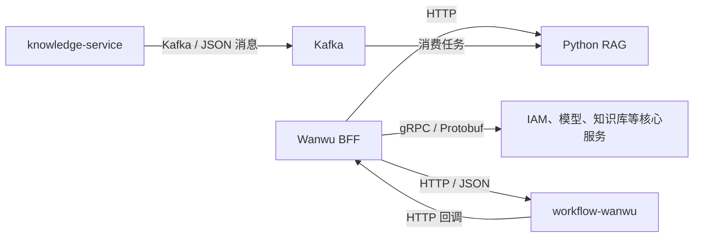

# 开源项目架构与通信协议分析

分析日期：2026-10-20。依据本地源码、进程入口、客户端实现及部署配置，未启动业务服务或验证线上流量。

## 结论

四个仓库并非都采用微服务架构。Haystack 是编排库；WeKnora 是主业务集中、部分能力独立部署的应用；Wanwu 明确拆分业务微服务；Wanwu-workflow 在万悟中作为独立工作流服务运行，其内部大量领域模块仍在同一进程内调用。

| 本地仓库 | 提交 | 架构判断 | 主要交互方式 |
| --- | --- | --- | --- |
| WeKnora | `c3f077e` | 模块化 Go 主服务 + 独立 Python 文档解析服务 + 基础设施 | 内部 Go 方法调用；解析默认 gRPC/Protobuf；异步任务 Redis/Asynq；HTTP API、SSE |
| haystack | `c5e1335` | Python 组件/Pipeline/Agent 编排框架 | 组件默认通过进程内 Python 方法和对象交互；外部服务通信由具体组件负责 |
| wanwu | `a16301c` | BFF + 多个独立业务服务 + 工作流/RAG 等能力服务 | Go 核心服务 gRPC/Protobuf；工作流、RAG 等 HTTP；文档处理 Kafka/JSON |
| wanwu-workflow | `6250357f` | 万悟中的独立工作流子系统；内部模块集中装配 | 内部 Go 接口调用；对平台 HTTP/JSON 与模型兼容接口；流式结果 SSE |

这里将“独立服务”按实际进程及部署边界判断，不按类名、目录名、IDL service 名称或 Docker 容器数量判断。数据库、缓存、对象存储不计为业务微服务。

## WeKnora

### 部署和业务边界

`cmd/server/main.go:59` 调用 `container.BuildContainer(...)`。`internal/container/container.go:230` 起将租户、知识库、文档、模型、用户等服务构造器注册到同一依赖注入容器。因此这些 `Service` 是主应用中的业务对象，不能据名称认定为独立微服务。

标准 Compose 中 `app` 与 `docreader` 分开部署。前者运行主业务，后者运行 Python 文档解析。可选搜索、存储、观测组件不代表业务被按领域逐一拆分。

### 通信

- 主服务 → DocReader：默认 gRPC + Protobuf，Compose 默认地址 `docreader:50051`。`internal/infrastructure/docparser/grpc_parser.go:65` 建立 gRPC 连接，`:72` 创建生成客户端。
- `docreader/proto/docreader.proto:7` 定义 `Read`、服务端流式 `ReadStream` 和 `ListEngines`。客户端优先调用 `ReadStream`，旧服务未实现时回退 `Read`（`grpc_parser.go:128`）。这里的流式传输是 gRPC streaming。
- Python 服务端在 `docreader/main.py:299` 创建 `grpc.server`，`:308` 注册 DocReader Servicer。
- 解析客户端还支持 HTTP 适配：`internal/container/container.go:1687` 根据 `DOCREADER_TRANSPORT` 选择实现，未设置时默认 gRPC。HTTP 选项不代表上述 Python 服务同时提供同一套 HTTP 端点。
- 异步任务使用 Asynq/Redis。`internal/router/task.go:97` 创建客户端，`:138` 创建任务服务器；`:324` 起在 goroutine 中启动消费者。`internal/container/container.go:608` 在构建主应用时启动这些消费者，所以默认不是一个独立 Worker 微服务。无 Redis 时另有进程内任务实现。
- 面向客户端的问答流使用 SSE，例如 `internal/handler/session/helpers.go:184` 设置 `text/event-stream`；SSE 与 DocReader 的 gRPC streaming 是两条不同链路。

## Haystack

`haystack/core/pipeline/pipeline.py:157` 从组件元数据取出 Python 实例，`:169` 直接执行 `instance.run(**inputs_copy)`，`:189` 检查返回值是 Mapping。

因此，Pipeline 中 Retriever、Generator、Router 等节点默认是进程内组件，不是每个节点各起一个服务。`Pipeline.connect()` 连接组件输入输出，其实现见 `haystack/core/pipeline/base.py:587`；这里的连接不是网络连接。

同步、异步、流式执行是库的运行方式，不等于分布式部署。组件可以调用远程模型或数据库，但这些网络协议属于对应的集成实现，并不存在统一的“Haystack 微服务间协议”。

`README.md:76` 将通过 REST API 或 MCP 提供 Pipeline 的能力指向另一个项目 Hayhooks。这是服务化封装方式，不能把 Haystack 核心组件据此认定为微服务。

## Wanwu

### 部署和同步调用

`docker-compose.yaml:241` 起定义独立的 BFF、IAM、模型、MCP、知识库、RAG 管理、助手、Agent、运营、应用、渠道等服务，并以各自的 `./bin/...` 命令启动；工作流另以 `./bin/workflow-wanwu` 启动（`:824`）。

`internal/bff-service/service/service.go:58` 创建多个服务连接，`:97` 起实例化生成的 gRPC 客户端，`:123` 的连接函数调用 `trace_util.NewGrpcTracerConn`。这证明核心管理调用真实经过 gRPC，而不是仅有 Proto 文件或依赖声明。

服务端例证是 `internal/iam-service/server/grpc/server.go:48` 起创建服务器、注册 IAM 和权限接口，并监听 TCP 地址；`cmd/iam-service/main.go:79` 启动该服务器。

注意：一个 Proto service 不一定对应一个部署服务。BFF 的 IAM 和 Perm 客户端共用 `iamConn`，多个知识库接口共用 `knowledgeBaseConn`。不能按 Proto service 数量统计微服务数量。

### HTTP 与异步处理

- BFF → 工作流：HTTP/JSON，`internal/bff-service/service/workflow.go:51` 起构造实际请求；地址由 `configs/microservice/bff-service/configs/config.yaml:282` 配置，默认 `http://workflow-wanwu:8999`。
- BFF → Python RAG 能力：HTTP，配置见同一文件 `:266`，区分检索、聊天及上传地址。Go `rag-service` 与 Python `rag-wanwu` 是不同边界，不能混为同一个全走 gRPC 的服务。
- 知识库 → Kafka → Python RAG：异步消息。`internal/knowledge-service/service/rag_doc_service.go:219` 调用发送函数；`internal/knowledge-service/pkg/mq/kafka.go:142` 先 JSON 序列化，再通过 Sarama 发送 Kafka 消息。
- Python 消费端见 `rag/rag_open_source/rag_core/asyn_add_file.py:59`，直接创建 `KafkaConsumer` 消费文档任务。Kafka 是消息系统，在线路上使用其原生协议，不是 HTTP/REST。
- 结果和状态回调还有 HTTP 路径，部署配置包含指向 BFF callback 端点的地址。同步接口与异步任务并存。

该图只展示已核对的代表性链路，不表示全部调用关系。

## Wanwu-workflow

### 实际启动方式

仓库保留 Coze Studio 上游代码和介绍，不能仅依据 `README.coze.zh_CN.md` 的微服务表述判断万悟实际部署。

`Dockerfile.wanwu-backend:9` 从 `wanwu-backend` 构建，`:18` 拷贝 `workflow-wanwu` 可执行文件。`wanwu-backend/go.mod:6` 用本地 `../backend` 替换上游 Coze 模块，说明这些后端代码被编译链接进本地程序，而非仅凭模块依赖就能认定为远程服务。

`wanwu-backend/cmd/workflow-wanwu/main.go:101` 初始化工作流模块，`:108` 启动 HTTP 服务。`wanwu-backend/internal/service/workflow/init.go:105` 创建领域服务，`:116` 直接赋给应用层对象；`:128`、`:139`、`:149` 等继续注册本地领域实现。这是进程内依赖装配。

因此，从整个平台看它是独立子系统；从该程序内部看，所检查的领域模块属于同一进程中的模块化实现，不是每个领域或工作流节点各起一个微服务。

### 通信

- 对外 HTTP 服务使用 Hertz，见 `wanwu-backend/internal/server/http/init.go:18`。工作流执行等 HTTP 路由见 `internal/server/http/router/init.go:203` 起。
- 工作流 → 知识库：`backend/domain/workflow/internal/nodes/knowledge/knowledge_retrieve_wanwu.go:392` JSON 序列化后调用 `PostJson`，地址来自 `WANWU_KNOWLEDGE_SEARCH_URL`。
- 工作流 → 模型能力：`backend/domain/workflow/internal/nodes/wanwu-llm-util/llm.go:55` 使用 BFF 模型回调地址，`:75` 创建 OpenAI 协议模型客户端；相关能力查询也使用 HTTP/JSON。
- 流式执行结果：`backend/api/handler/coze/workflow_service.go:1042` 创建 SSE Writer，`:1044` 设置 `text/event-stream`。
- 持有 Thrift IDL、生成类型或 gRPC 依赖，并不能单独证明部署中的内部通信使用 Thrift RPC 或 gRPC；本次确认的平台接入边界是 HTTP。

## 阅读和复用时的区别

1. 组件编排、领域分层、异步执行和微服务拆分是不同维度。要判断微服务，必须同时看进程入口、部署边界以及真实客户端/服务端调用。
2. 服务间通信没有统一答案：Wanwu 的核心 RPC、能力 HTTP 接口和 Kafka 任务属于不同路径。
3. “模块数量”“Proto service 数量”“容器数量”都不等于业务微服务数量。
4. 本次是静态源码核对，未验证正在运行的配置、流量、延迟、吞吐量或部署可用性；端口与调用方式以所列本地提交及默认配置为准。
